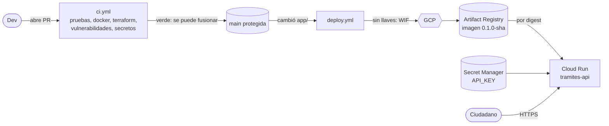

# tramites-platform

Plataforma para que el equipo de desarrollo despliegue solo, sin pedirle ayuda a DevOps.
La app de ejemplo es la consulta de estado de trámite del "Ministerio de Trámites
Ciudadanos" (ficticio): el ciudadano manda su número y ve en qué va.

**En una frase:** abres un PR, el pipeline lo revisa, haces merge y en un par de minutos
está en producción en Cloud Run.

> **Uso de IA.** Construí este repositorio con ayuda de **Claude (Anthropic), Claude
> Opus 5.5, desde Claude Code**: Terraform, workflows, Dockerfile. Lo revisé, lo apliqué en mi proyecto. Los
> commits hechos con el asistente conservan su atribución (`Co-Authored-By: Claude ...`).

## Cómo funciona



| Qué | Dónde |
|---|---|
| La API (FastAPI): `/health` y `/tramites/{numero}` | `app/` |
| Toda la infraestructura, un solo Terraform con state en GCS | `terraform/` |
| Revisión de cada PR | `.github/workflows/ci.yml` |
| Despliegue al fusionar | `.github/workflows/deploy.yml` |
| Atajos para correr la app en tu máquina | `Makefile` |

### Los dos pipelines

- **ci** corre en cada PR: ruff y pytest, construye la imagen (verifica que no corra como
  root y la escanea con Trivy), valida Terraform y busca secretos con gitleaks en todo el
  historial. `main` está protegida: sin estos checks en verde no se puede fusionar.
- **deploy** corre al fusionar a `main` si cambió `app/`: construye la imagen, la publica
  como `0.1.0-<sha>` (nunca `:latest`), la despliega por digest y comprueba que `/health`
  responda con la versión nueva. No repite las pruebas: ya pasaron en el PR.

### Quién puede llamar a la API

- `GET /health` es **público a propósito**: lo usan Cloud Run y el smoke test, no expone datos.
- `GET /tramites/{numero}` pide la cabecera `X-API-Key`. El valor vive en Secret Manager y
  Cloud Run lo entrega a la app como variable `API_KEY`. Si falta, la API responde 503.

## Probar la app en tu máquina

```bash
cp .env.example .env          # pon cualquier valor en API_KEY
make run-local                # o: make run-local PORT=8081 si el 8080 está ocupado
curl -H "X-API-Key: <tu valor>" http://localhost:8080/tramites/TRM-2026-000123
```

`make test` y `make lint` corren lo mismo que revisa el pipeline.

## Desplegar desde cero

Necesitas `gcloud`, `terraform` 1.11 o más nuevo, `docker`, `gh` y un proyecto de GCP con
facturación.

```bash
# 1. Tus credenciales
gcloud auth login && gcloud auth application-default login
gcloud config set project <PROJECT_ID>
gcloud auth application-default set-quota-project <PROJECT_ID>
gcloud services enable cloudresourcemanager.googleapis.com serviceusage.googleapis.com

# 2. Infraestructura (detalle paso a paso en terraform/README.md)
cd terraform
cp terraform.tfvars.example terraform.tfvars    # completa tus valores
printf 'terraform {\n  backend "local" {}\n}\n' > backend_override.tf
terraform init && terraform apply               # crea todo, con state local la primera vez
rm backend_override.tf
terraform init -migrate-state -force-copy -backend-config="bucket=<PROJECT_ID>-tfstate"
rm -f terraform.tfstate terraform.tfstate.backup

# 3. Variables que usa el pipeline (son nombres de recursos, no secretos)
terraform output -json github_variables \
  | python3 -c 'import json,sys; [print(k, v) for k, v in json.load(sys.stdin).items()]' \
  | while read -r k v; do gh variable set "$k" --body "$v"; done
cd ..

# 4. Proteger main: PR obligatorio con los checks de ci en verde
gh api -X PUT repos/<usuario>/tramites-platform/branches/main/protection --input - <<'JSON'
{
  "required_status_checks": {"strict": true, "contexts": [
    "app (ruff + pytest)", "docker build (non-root + vulnerabilidades)",
    "terraform fmt + validate", "secret scan (gitleaks)"]},
  "enforce_admins": true,
  "required_pull_request_reviews": {"required_approving_review_count": 0},
  "restrictions": null, "allow_force_pushes": false, "allow_deletions": false
}
JSON

# 5. Primer despliegue y prueba
gh workflow run deploy.yml && gh run watch
URL=$(terraform -chdir=terraform output -raw service_url)
KEY=$(gcloud secrets versions access latest --secret=tramites-api-key)
curl $URL/health
curl -H "X-API-Key: $KEY" $URL/tramites/TRM-2026-000123
```

**Destruir todo:** ver "Destruir todo" en `terraform/README.md`. Es un `terraform destroy`
precedido de bajar el state a local, porque el bucket del state también se borra.

## Decisiones (y lo que descarté)

1. **El pipeline entra a GCP con Workload Identity Federation (reto de la Parte B, opción 1).**
   GitHub presenta un token de corta duración y solo `deploy.yml` en `main` puede usar la
   cuenta `gha-deployer`, que solo puede publicar en este repo de imágenes y desplegar este
   servicio. *Descarté* llaves JSON (se filtran y no expiran) y dar acceso a todo el repo
   (cualquier workflow nuevo en un PR podría desplegar).
2. **Un solo Terraform con un solo state, y Terraform crea su propio bucket.** El primer apply
   guarda el state en local y después se sube al bucket. *Descarté* dos stacks separados
   (empecé así y el state local del primero se perdió) y crear el bucket a mano.
3. **La API key la genera Terraform sin guardarla nunca.** Usa un valor efímero y un argumento
   *write-only*: va directo a Secret Manager y no queda ni en el state ni en el plan.
   *Descarté* ponerla en `terraform.tfvars` (quedaría en texto plano en el state) y cargarla a
   mano (un paso más y un segundo apply).
4. **Dos pipelines simples; la seguridad la da la protección de `main`.** *Descarté* encadenar
   deploy a ci con `workflow_run`: para mantener la simplicidad.
5. **El pipeline es dueño de la imagen; Terraform, de todo lo demás.** *Descarté* que el
   pipeline corra `terraform apply`: su cuenta necesitaría permisos casi de Owner.


## Costo

Objetivo: menos de USD 10 en total; esperado menos de USD 1 al mes con tráfico de prueba.
Cloud Run escala a cero, Artifact Registry borra imágenes viejas (conserva las 5 más
recientes) y hay una **alerta de presupuesto** de USD 10 que avisa por correo al 50, 90 y
100 %. La alerta avisa, no corta el gasto.

## Pendiente


- `terraform plan` comentado en cada PR que toque `terraform/`; hoy la infraestructura la
  aplica una persona desde su computadora.
- Para tráfico de todo el país: instancias mínimas en horario laboral, un uptime check con
  alerta y Cloud Armor con límite de peticiones.
- Atar WIF también al ID del repositorio, para que un repo recreado con el mismo nombre no
  herede el acceso.
