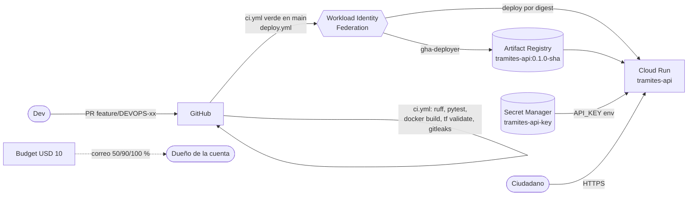

# tramites-platform

Plataforma mínima de despliegue en GCP para la consulta de estado de trámite del
"Ministerio de Trámites Ciudadanos" (prueba técnica DevOps Tech Lead).

Un ciudadano consulta `GET /tramites/{numero}` y obtiene el estado. Los equipos de
desarrollo despliegan solos: merge a `main` → imagen versionada → Cloud Run.

> **Uso de IA.** Este repositorio se construyó con ayuda de **Claude (Anthropic), modelo
> Claude Opus 5.5, usado desde Claude Code**: andamiaje del repo, Terraform, workflows de
> GitHub Actions y primeros borradores de la documentación. Todo lo revisé, lo apliqué en mi
> proyecto y lo puedo explicar. Los commits hechos con el asistente conservan el trailer
> `Co-Authored-By: Claude ...`; **no se eliminó la atribución**.

## Arquitectura



| Ruta | Qué hay |
|---|---|
| `app/` | API FastAPI (`/health`, `/tramites/{numero}`), pruebas, `Dockerfile` multistage no-root, `uv.lock` |
| `infra/bootstrap/` | Estado **local**: bucket del estado remoto, APIs, pool/proveedor WIF, alerta de presupuesto |
| `infra/platform/` | Estado **remoto en GCS**: Artifact Registry, Secret Manager, Cloud Run, cuentas de servicio |
| `.github/workflows/` | `ci.yml` (PR y main), `deploy.yml` (tras ci verde en main) |
| `CRITERIO.md` | Parte C: ADR, automatizaciones, tiempo de ingeniería |
| `docs/sesion-en-vivo.md` | Chuleta para la sesión en vivo (consola y gcloud) |

### Autenticación de la API (decisión explícita)

- `GET /health`: **público a propósito** (lo usan Cloud Run y el smoke test; no expone datos).
- `GET /tramites/{numero}`: exige la cabecera `X-API-Key`. El valor esperado es el secreto
  `tramites-api-key` de Secret Manager, que Cloud Run inyecta como variable `API_KEY`. Si el
  secreto falta, responde 503 (falla cerrado). La llave nunca se registra en logs.
- Cloud Run permite `allUsers` como invocador: es un servicio ciudadano. La API key
  representa al cliente (el frontend del ministerio), no al ciudadano.

## Estándares del repositorio

- Trunk-based: `main` protegida, todo entra por PR con pipeline en verde. Ramas
  `feature/{ticket}-desc`, `fix/{ticket}`, `hotfix/{ticket}` (tickets `DEVOPS-xx`).
- Conventional Commits (`feat:`, `fix:`, `chore:`, `docs:`, `security:`, `ci:`).
- Versiones fijadas: providers en `.terraform.lock.hcl`, Python en `uv.lock`, imágenes base
  por versión **y** digest, actions por SHA de commit, gcloud y Terraform por versión.
  Nunca se despliega `:latest`: se despliega por digest.
- Sin credenciales en git: `.env`, `*.tfvars` y llaves JSON están en `.gitignore`; gitleaks
  escanea todo el historial en cada PR; no existen llaves de cuentas de servicio (WIF).

## Despliegue desde cero

Requisitos: `gcloud`, `terraform` 1.15.x, `uv`, `docker`, `gh`, `make`. Proyecto GCP propio con
facturación enlazada. Todo lo que sigue se ejecuta con **tus** credenciales.

```bash
# 0. Credenciales locales y configuración
gcloud auth login
gcloud auth application-default login
gcloud config set project <PROJECT_ID>
gcloud auth application-default set-quota-project <PROJECT_ID>
gcloud services enable cloudresourcemanager.googleapis.com serviceusage.googleapis.com
cp .env.example .env   # completar PROJECT_ID, BILLING_ACCOUNT_ID, GITHUB_REPO, API_KEY...

# 1. Repositorio en GitHub (público: la protección de ramas en repos privados requiere plan pago)
gh repo create <usuario>/tramites-platform --public --source . --remote origin
git push origin main
# Protección de main: PR obligatorio + checks de ci.yml en verde, sin force-push
gh api -X PUT repos/<usuario>/tramites-platform/branches/main/protection --input - <<'JSON'
{
  "required_status_checks": {"strict": true, "contexts": [
    "app (ruff + pytest)", "docker build (non-root)", "secret scan (gitleaks)"]},
  "enforce_admins": true,
  "required_pull_request_reviews": {"required_approving_review_count": 0},
  "restrictions": null,
  "allow_force_pushes": false,
  "allow_deletions": false
}
JSON

# 2. PRs en orden (ver tabla abajo). Tras fusionar DEVOPS-02, exigir también los checks de Terraform:
gh api -X POST repos/<usuario>/tramites-platform/branches/main/protection/required_status_checks/contexts \
  --input - <<'JSON'
{"contexts": ["terraform fmt + validate (infra/bootstrap)", "terraform fmt + validate (infra/platform)"]}
JSON
git checkout main && git pull
make bootstrap            # bucket de estado, APIs, WIF, presupuesto

# 3. Tras fusionar DEVOPS-03:
make platform-init        # conecta con el bucket <PROJECT_ID>-tfstate
make platform-secret      # crea el secreto (sin valor)
make secret-version       # pide el valor de API_KEY y lo agrega como versión
make platform             # Cloud Run (imagen placeholder), AR, IAM
#   Tarda ~1 min de más: un time_sleep espera a que IAM propague el permiso secretAccessor antes
#   de crear Cloud Run (cloud_run.tf), así el primer apply no falla con "permission denied".
make github-vars          # carga GCP_* y demás variables en GitHub Actions

# 4. Fusionar DEVOPS-05 (deploy.yml): el merge dispara el primer despliegue real.
gh run watch
URL=$(gcloud run services describe tramites-api --region <REGION> --format='value(status.url)')
curl $URL/health
curl -H "X-API-Key: <valor>" $URL/tramites/TRM-2026-000123

# 5. Fusionar DEVOPS-07 (docs). Probar: docs/sesion-en-vivo.md.
```

Orden de PRs (ramas apiladas; fusionar con **merge commit** para que cada rama siguiente
siga aplicando limpio y se conserven los trailers de los commits):

| # | Rama | Contenido |
|---|---|---|
| 1 | `feature/DEVOPS-01-api-tramites` | App, Dockerfile, `.env.example`, CI de PR |
| 2 | `feature/DEVOPS-02-bootstrap-gcp` | Bucket de estado, APIs, WIF, presupuesto, `Makefile`; validación de Terraform en CI |
| 3 | `feature/DEVOPS-03-plataforma-cloud-run` | AR, Secret Manager, Cloud Run, cuentas de servicio |
| 4 | `feature/DEVOPS-04-binary-authorization` | KMS, attestor, política BinAuthz (retirado en DEVOPS-15) |
| 5 | `feature/DEVOPS-05-pipeline-deploy` | `deploy.yml` (build, deploy por digest) |
| 6 | `feature/DEVOPS-06-drift-detection` | `drift.yml` + issue automático (retirado en DEVOPS-15) |
| 7 | `feature/DEVOPS-07-documentacion` | README, CRITERIO.md, chuleta de sesión en vivo |

### Destruir todo

```bash
make destroy   # primero infra/platform (estado remoto), al final infra/bootstrap (bucket y presupuesto)
```

Lo que **no** desaparece y por qué no cuesta:

- **Workload Identity Pool**: queda 30 días en soft-delete. Para recrear antes, cambiar
  `wif_pool_id` o `gcloud iam workload-identity-pools undelete github --location=global`.
- Las APIs quedan habilitadas (`disable_on_destroy = false`), sin costo.

## Decisiones (y lo que se descartó)

1. **La infraestructura la aplica una persona desde su laptop; el pipeline solo despliega la
   app.** Descartado: un workflow de `terraform apply` con su propia cuenta. Esa cuenta
   necesitaría administrar IAM (casi Owner) y sería la credencial más valiosa
   del repo; para una persona y pocos cambios de infra no compensa.
   *Revisar* cuando más de una persona cambie infra: `plan` en el
   PR + `apply` al fusionar con aprobación (GitHub Environments).
2. **El pipeline es dueño de la imagen; Terraform de todo lo demás** (`ignore_changes` sobre
   la imagen de Cloud Run). Descartado: que el pipeline corra `terraform apply -var image=...`
   (la cuenta de deploy tendría que escribir estado y tener permisos de toda la infra) y que
   gcloud cree el servicio completo (la configuración de Cloud Run dejaría de ser código).
   Costo: el servicio se crea con una imagen *placeholder* de Google.
3. **WIF atado a cada workflow, no al repositorio.** `gha-deployer` solo lo puede usar
   `deploy.yml` en `main` (claim `workflow_ref`).
   Descartado: binding por repositorio (cualquier workflow, incluido uno agregado en un PR,
   podría desplegar). El proveedor además rechaza tokens de cualquier otro repo
   (`attribute_condition`).
4. **El valor del secreto nunca pasa por Terraform.** Terraform crea el secreto y el permiso;
   el valor se agrega con `gcloud secrets versions add`. Descartado:
   `google_secret_manager_secret_version` con el valor en tfvars (quedaría en texto plano en el
   estado del bucket).
5. **Versión = SemVer de `app/pyproject.toml` + SHA corto** (`0.1.0-abc1234`), etiquetas
   inmutables en Artifact Registry y despliegue por digest. Descartado:
   release-please/semantic-release (más piezas para una prueba) y etiquetas mutables. Subir
   la versión es parte del PR.
6. **GitHub Actions en vez de Cloud Build**: ver `CRITERIO.md`.

## Costo estimado

Objetivo: < USD 10 en total; esperado **< USD 1/mes** con tráfico de prueba.

| Recurso | Costo |
|---|---|
| Cloud Run (min 0, max 2, CPU solo en request) | Dentro de la capa gratuita |
| Artifact Registry (≤ 5 imágenes de ~60 MB, limpieza automática) | 0.5 GB gratis → ~USD 0 |
| Secret Manager (1 secreto, pocas versiones) | Capa gratuita |
| GCS (estado de Terraform, KB) | ~USD 0 |
| WIF, IAM, presupuesto | Sin costo |
| GitHub Actions (repo público) | Sin costo |

No se habilita el escaneo de vulnerabilidades de Artifact Analysis (cobra por imagen).
La alerta de presupuesto **avisa, no corta** el gasto.

## Pendiente

- `terraform plan` comentado en cada PR que toque `infra/` y `apply` automatizado con aprobación.
- El estado de `infra/bootstrap` es local; migrarlo al bucket.
- Condición de WIF por `repository_id`/`repository_owner_id` (además del nombre) para que un
  repo recreado con el mismo nombre no herede el acceso.
- Escaneo de vulnerabilidades de la imagen (Trivy en CI o Artifact Analysis).
- Ambiente de staging y GitHub Environments con aprobación para producción.
- Observabilidad: uptime check y alerta de tasa de errores/latencia (SLO).
- Rotación periódica de `API_KEY` y rate limiting (Cloud Armor/API Gateway).
- Workflows reutilizables para que equipos Go/React se sumen sin copiar YAML (ver CRITERIO).
- Acción automática sobre el presupuesto (Pub/Sub → deshabilitar facturación) si se quisiera
  un tope duro.
